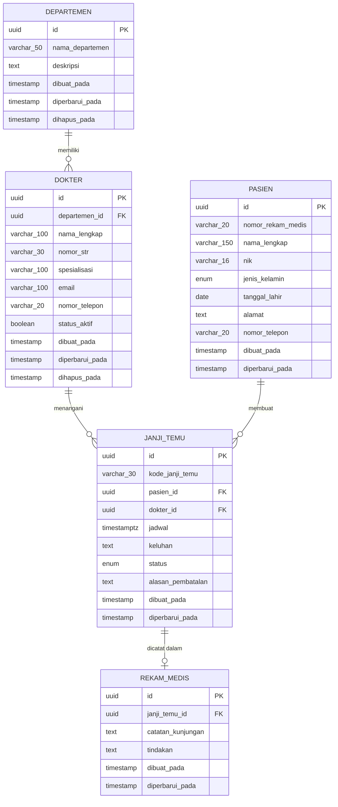

# ERD — Clinic Management System

Dokumen ini menjelaskan rancangan database: entitas, atribut, primary key, foreign key, relasi, dan alasan pemilihan nama kolom. Gambar lengkap ada di file `erd.png`.


## 1. Diagram (Mermaid)



Arti simbol: `||` tepat satu, `o{` nol atau banyak, `o|` nol atau satu.

## 2. Relasi

| Relasi | Kardinalitas | Foreign key | Aturan hapus | Penjelasan |
|---|---|---|---|---|
| departemen — dokter | 1 : N | `dokter.departemen_id` | RESTRICT | Satu departemen punya banyak dokter; satu dokter hanya di satu departemen |
| pasien — janji_temu | 1 : N | `janji_temu.pasien_id` | RESTRICT | Satu pasien bisa punya banyak janji temu |
| dokter — janji_temu | 1 : N | `janji_temu.dokter_id` | RESTRICT | Satu dokter menangani banyak janji temu |
| janji_temu — rekam_medis | 1 : 0..1 | `rekam_medis.janji_temu_id` (UNIQUE) | RESTRICT | Satu janji temu paling banyak punya satu catatan kunjungan |

`RESTRICT` artinya induk tidak bisa dihapus selama masih punya anak, sehingga tidak ada data yatim (anak tanpa induk).

**Pasien dan dokter adalah hubungan many-to-many** (banyak pasien bertemu banyak dokter). Hubungan ini dipecah lewat tabel penghubung `janji_temu` yang juga membawa data tambahan (jadwal, keluhan, status).

## 3. Kamus Data

### Tabel `departemen`

| Key | Kolom | Tipe data | Keterangan |
|---|---|---|---|
| PK | `id` | uuid | dibuat otomatis (UUID v4) |
|  | `nama_departemen` | varchar(50) | UNIQUE, NOT NULL |
|  | `deskripsi` | text | NULL (boleh kosong) |
|  | `dibuat_pada` | timestamp | otomatis saat data dibuat |
|  | `diperbarui_pada` | timestamp | otomatis saat data diubah |
|  | `dihapus_pada` | timestamp | NULL (disiapkan untuk soft delete) |

### Tabel `dokter`

| Key | Kolom | Tipe data | Keterangan |
|---|---|---|---|
| PK | `id` | uuid | dibuat otomatis (UUID v4) |
| FK | `departemen_id` | uuid | NOT NULL, ON DELETE RESTRICT |
|  | `nama_lengkap` | varchar(100) | NOT NULL |
|  | `nomor_str` | varchar(30) | UNIQUE, NOT NULL |
|  | `spesialisasi` | varchar(100) | NOT NULL |
|  | `email` | varchar(100) | UNIQUE, NOT NULL |
|  | `nomor_telepon` | varchar(20) | NOT NULL |
|  | `status_aktif` | boolean | DEFAULT true |
|  | `dibuat_pada` | timestamp | otomatis |
|  | `diperbarui_pada` | timestamp | otomatis |
|  | `dihapus_pada` | timestamp | NULL (disiapkan untuk soft delete) |

### Tabel `pasien`

| Key | Kolom | Tipe data | Keterangan |
|---|---|---|---|
| PK | `id` | uuid | dibuat otomatis (UUID v4) |
|  | `nomor_rekam_medis` | varchar(20) | UNIQUE, NOT NULL, dibuat sistem |
|  | `nama_lengkap` | varchar(150) | NOT NULL |
|  | `nik` | varchar(16) | UNIQUE, NOT NULL (16 digit) |
|  | `jenis_kelamin` | enum | LAKI_LAKI | PEREMPUAN |
|  | `tanggal_lahir` | date | NOT NULL (tanpa jam) |
|  | `alamat` | text | NOT NULL |
|  | `nomor_telepon` | varchar(20) | NOT NULL |
|  | `dibuat_pada` | timestamp | otomatis |
|  | `diperbarui_pada` | timestamp | otomatis |

### Tabel `janji_temu`

| Key | Kolom | Tipe data | Keterangan |
|---|---|---|---|
| PK | `id` | uuid | dibuat otomatis (UUID v4) |
|  | `kode_janji_temu` | varchar(30) | UNIQUE, NOT NULL, dibuat sistem |
| FK | `pasien_id` | uuid | NOT NULL, ON DELETE RESTRICT |
| FK | `dokter_id` | uuid | NOT NULL, ON DELETE RESTRICT |
|  | `jadwal` | timestamptz | NOT NULL (tanggal + jam + zona waktu) |
|  | `keluhan` | text | NOT NULL |
|  | `status` | enum | DEFAULT TERJADWAL |
|  | `alasan_pembatalan` | text | NULL (wajib saat DIBATALKAN) |
|  | `dibuat_pada` | timestamp | otomatis |
|  | `diperbarui_pada` | timestamp | otomatis |

### Tabel `rekam_medis`

| Key | Kolom | Tipe data | Keterangan |
|---|---|---|---|
| PK | `id` | uuid | dibuat otomatis (UUID v4) |
| FK | `janji_temu_id` | uuid | UNIQUE, NOT NULL, ON DELETE RESTRICT |
|  | `catatan_kunjungan` | text | NOT NULL |
|  | `tindakan` | text | NULL (boleh kosong) |
|  | `dibuat_pada` | timestamp | otomatis |
|  | `diperbarui_pada` | timestamp | otomatis |

Enum: `jenis_kelamin_enum` = LAKI_LAKI, PEREMPUAN. `status_janji_temu_enum` = TERJADWAL, DIKONFIRMASI, SELESAI, DIBATALKAN.

Index tambahan: `IDX_janji_temu_dokter_jadwal` pada (`dokter_id`, `jadwal`) untuk mempercepat pengecekan jadwal bentrok.

## 4. Alasan Pemilihan Nama Kolom dan Tipe Data

| Pilihan | Alasan |
|---|---|
| Nama tabel/kolom `snake_case` huruf kecil | Kebiasaan umum PostgreSQL (tanpa tanda kutip). Di kode TypeScript memakai `camelCase`; keduanya dihubungkan oleh `@Column({ name: '...' })` |
| `id` bertipe `uuid` | Tidak bisa ditebak (aman), tidak bentrok antar server, dan tidak membocorkan jumlah data |
| `nomor_rekam_medis` | Nomor identitas pasien di klinik (`RM-20261112-4821`), dibuat sistem, UNIQUE |
| `nik` `varchar(16)` | NIK adalah angka 16 digit tetapi bukan untuk dihitung; disimpan sebagai teks agar angka 0 di depan tidak hilang |
| `jenis_kelamin` enum | Nilainya terbatas; database sendiri menolak nilai di luar daftar |
| `tanggal_lahir` `date` | Hanya butuh tanggal, tanpa jam |
| `nomor_str` | Surat Tanda Registrasi dokter; UNIQUE karena satu nomor milik satu dokter |
| `status_aktif` boolean | Menonaktifkan dokter tanpa menghapus riwayat janjinya |
| `jadwal` `timestamptz` | Tanggal + jam + zona waktu, disimpan dalam UTC agar tidak salah jam |
| `status` enum | Alur status terbatas (TERJADWAL, DIKONFIRMASI, SELESAI, DIBATALKAN) |
| `alasan_pembatalan` NULL | Hanya terisi saat janji dibatalkan |
| `kode_janji_temu` | Kode mudah dibaca manusia (`JT-20261112-K7Q2X`) untuk disebut di loket, berbeda dari UUID |
| `catatan_kunjungan`, `tindakan` `text` | Isi catatan bisa panjang. `tindakan` opsional dan bukan diagnosis |
| `janji_temu_id` UNIQUE di `rekam_medis` | Memaksa aturan satu janji = paling banyak satu rekam medis di level database |
| `dibuat_pada`, `diperbarui_pada` | Jejak waktu otomatis (audit sederhana) |
| `dihapus_pada` (departemen, dokter) | Disiapkan untuk *soft delete*; saat ini penghapusan bersifat permanen sehingga kolom selalu NULL |

## 5. Kolom yang Dihapus dari `rekam_medis`

Kolom `tekanan_darah` (varchar 10), `suhu_tubuh` (decimal 4,1), dan `berat_badan` (decimal 5,2) sudah **dihapus** dari entity, DTO, dan dokumentasi. Rekam medis kini hanya berisi `catatan_kunjungan` dan `tindakan`, sesuai batasan tugas (tanpa diagnosis klinis).

## 6. Gambaran SQL Setara (ilustrasi)

TypeORM membuat tabel otomatis (`synchronize`). SQL berikut hanya gambaran agar mudah dibaca; nama constraint asli buatan TypeORM berbentuk hash.

```sql
CREATE TYPE jenis_kelamin_enum AS ENUM ('LAKI_LAKI','PEREMPUAN');
CREATE TYPE status_janji_temu_enum AS ENUM ('TERJADWAL','DIKONFIRMASI','SELESAI','DIBATALKAN');

CREATE TABLE departemen (
  id uuid PRIMARY KEY DEFAULT uuid_generate_v4(),
  nama_departemen varchar(50) NOT NULL UNIQUE,
  deskripsi text,
  dibuat_pada timestamp NOT NULL DEFAULT now(),
  diperbarui_pada timestamp NOT NULL DEFAULT now(),
  dihapus_pada timestamp
);
CREATE TABLE dokter (
  id uuid PRIMARY KEY DEFAULT uuid_generate_v4(),
  departemen_id uuid NOT NULL REFERENCES departemen(id) ON DELETE RESTRICT,
  nama_lengkap varchar(100) NOT NULL,
  nomor_str varchar(30) NOT NULL UNIQUE,
  spesialisasi varchar(100) NOT NULL,
  email varchar(100) NOT NULL UNIQUE,
  nomor_telepon varchar(20) NOT NULL,
  status_aktif boolean NOT NULL DEFAULT true,
  dibuat_pada timestamp NOT NULL DEFAULT now(),
  diperbarui_pada timestamp NOT NULL DEFAULT now(),
  dihapus_pada timestamp
);
CREATE TABLE pasien (
  id uuid PRIMARY KEY DEFAULT uuid_generate_v4(),
  nomor_rekam_medis varchar(20) NOT NULL UNIQUE,
  nama_lengkap varchar(150) NOT NULL,
  nik varchar(16) NOT NULL UNIQUE,
  jenis_kelamin jenis_kelamin_enum NOT NULL,
  tanggal_lahir date NOT NULL,
  alamat text NOT NULL,
  nomor_telepon varchar(20) NOT NULL,
  dibuat_pada timestamp NOT NULL DEFAULT now(),
  diperbarui_pada timestamp NOT NULL DEFAULT now()
);
CREATE TABLE janji_temu (
  id uuid PRIMARY KEY DEFAULT uuid_generate_v4(),
  kode_janji_temu varchar(30) NOT NULL UNIQUE,
  pasien_id uuid NOT NULL REFERENCES pasien(id) ON DELETE RESTRICT,
  dokter_id uuid NOT NULL REFERENCES dokter(id) ON DELETE RESTRICT,
  jadwal timestamptz NOT NULL,
  keluhan text NOT NULL,
  status status_janji_temu_enum NOT NULL DEFAULT 'TERJADWAL',
  alasan_pembatalan text,
  dibuat_pada timestamp NOT NULL DEFAULT now(),
  diperbarui_pada timestamp NOT NULL DEFAULT now()
);
CREATE INDEX "IDX_janji_temu_dokter_jadwal" ON janji_temu (dokter_id, jadwal);
CREATE TABLE rekam_medis (
  id uuid PRIMARY KEY DEFAULT uuid_generate_v4(),
  janji_temu_id uuid NOT NULL UNIQUE REFERENCES janji_temu(id) ON DELETE RESTRICT,
  catatan_kunjungan text NOT NULL,
  tindakan text,
  dibuat_pada timestamp NOT NULL DEFAULT now(),
  diperbarui_pada timestamp NOT NULL DEFAULT now()
);
```
